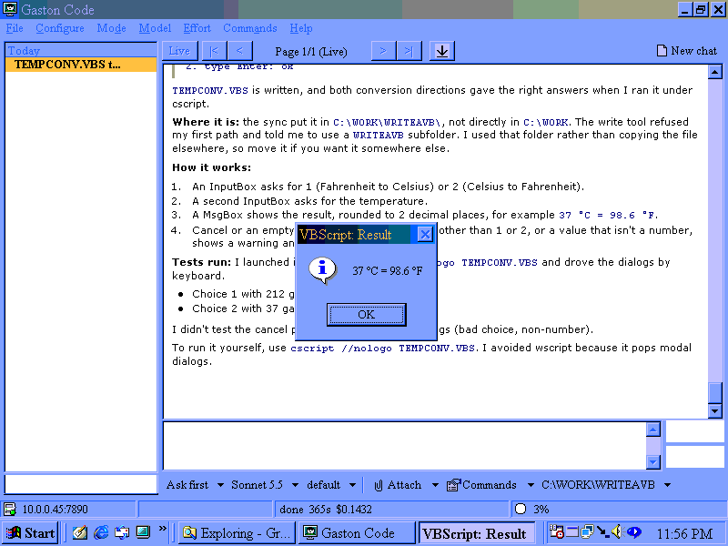

# Gaston Code

A native Windows 98 GUI client for Claude Code.

The Win98 machine is both the terminal you sit at and the workspace Claude
operates on. A bridge process on a modern Linux box runs Claude Code via the
Agent SDK and speaks a small framed protocol over the LAN to a single
executable on the guest.

Nobody has built this. The closest prior art each solves half of it:
[claudewin9x](https://github.com/ryandeering/claudewin9x) proxies the real CLI
but its client is a console REPL; [retro-agent](https://github.com/voidsstr/retro-agent)
has a complete guest tool surface and a hardened protocol but is headless and
drives the Agent SDK rather than Claude Code.



*A Pentium 200 MMX under Windows 98 SE. Asked for a Fahrenheit/Celsius
converter with a UI, the agent wrote `TEMPCONV.VBS`, launched it, drove its
dialogs from the keyboard to check both directions, and reported what it had
not tested. The dialog in front is that script running.*

## Why "Gaston Code"?

The name follows Claude Code. Claude is a French name, and Gaston is another
one: a companion name rather than a borrowed one.

It is also a nod to Gaston Lagaffe, André Franquin's office junior from
*Spirou* (1957 onwards). He works in a busy office, naps when he should be
filing, and builds contraptions on the office machines that nobody asked for.
Most of them go wrong in some memorable way. Handing an AI agent the keys to a
beige 1998 PC felt like the same spirit.

The application icon is a monitor with a mop-haired figure in a green
turtleneck on the screen. It is our own drawing, a wink at the character
rather than a copy of Franquin's art.

## Constraints that shape everything

- **32MB RAM**, ~8–12MB free after boot. Win98 swaps on a period IDE disk, so
  working-set size matters more than CPU.
- **Pentium MMX 200MHz.** Compression is a tradeoff, not a freebie.
- **10Mbps LAN (~750 KB/s), sometimes dialup (~5 KB/s).** Bandwidth is a
  first-class design input.
- **Open Watcom 2.0**, C++98 with its STL, ANSI Win32 APIs only. Nothing
  NT-only, ever: one NT-only static import kills the image at load,
  before `WinMain`, with no log written.

## Layout

```
docs/       GUIDE.md (how to set it up), ARCHITECTURE.md, REMOTE.md
            (gremote), PERMISSIONS.md, UIAUTOMATION.md, FORKED.md
make/       ow.mk -- shared Open Watcom rules
win/        the guest executables -- GASTON.EXE, GREMOTE.EXE, GUPDATE.EXE
bridge/     Python: Agent SDK, MCP tools, pagination, markdown, compression
gremote/    Python driver for the guest server, and how a build is shipped
tests/      protocol, markdown, encoding, PE import allowlist
            guest/ is the check binaries: the shipping C, run under Wine
research/   apparatus, not product -- probes, their host stubs, the numbers
tools/      check/ the build's own gates, vm/ QEMU and QMP scripts,
            gen/ the icon, the tools ISO and the install kit
vm/         QEMU run scripts (images gitignored)
```

`win/`, `bridge/`, `gremote/` and `tools/check/` are the product and the
build. `tests/` and `research/` are how it is judged, and nothing under
either ships. The split is deliberate: `win/checks/` used to hold both the
Wine test binaries and the probes that measure a real 1998 machine, under
one directory name that said neither.

## Download

Released builds are on the
[releases page](https://github.com/chibicitiberiu/gaston-code/releases).
**[docs/GUIDE.md](docs/GUIDE.md) is how to set it up**, and it ships as a
zip with the release so it can be read on the machine being set up.

| | |
|---|---|
| `gaston-code-<ver>-guide.zip` | the guide. Start here |
| `gaston-<ver>-win98.zip` | the GUI client, for the Windows 98 machine |
| `gremote-<ver>-win98.zip` | optional: lets another machine drive that one. A separate download because it opens a port |
| `gaston_code_bridge-<ver>-py3-none-any.whl` | the bridge, for Linux, macOS or Windows |

**Claude Code is a prerequisite.** The bridge runs the copy on your
machine rather than carrying its own, so install it and sign in first.
Then install the bridge with the agent SDK built from source:

```sh
export PIP_NO_BINARY=claude-agent-sdk
pipx install gaston_code_bridge-<ver>-py3-none-any.whl
```

Without that variable pip takes the SDK's platform wheel, which carries
its own copy of Claude Code -- 219 MB of the SDK's 220 -- and the SDK
prefers it to yours. The guide explains it, and what to do when your
Python is older than 3.11.

One wheel covers more ground than the three artefacts it replaced (a
Linux AppImage, a Windows zip and a container image), because every
compiled dependency publishes wheels for all three platforms and macOS
never had an artefact at all.

## Status

**Alpha.** It runs on a physical Pentium 200 MMX under Windows 98 SE,
installed over the network, driving tool-calling turns end to end. What
has not happened yet is a clean install by somebody who is not the
author, which is the thing an alpha is for. See `notes/PROGRESS.md` and
`notes/ROADMAP.md`.

## Build

```sh
make              # build the Win98 guest binary
make check        # static PE audit of the guest: imports, CMOV, frames, BSS
make test-fast    # the Python suite except the Wine runs -- the inner loop
make wine-smoke   # run under Wine (code sanity only, NOT a Win98 proof)
```

Requires Open Watcom 2.0 at `/usr/bin/watcom` (override with `WATCOM=`).
`.github/workflows/release.yml` pins a dated build and installs it from
`ow-snapshot.tar.xz`, which is the easiest way to get one.

To build all four release assets locally — the same scripts CI calls,
in the order they have to run, with one `SHA256SUMS` over the result:

```sh
make release
```

## Licence

**GNU AGPL v3 only** — see `LICENSE`.

Section 13 is the clause that matters for a program shaped like this one: if
you modify it and let people use it over a network, they are entitled to the
source of your modified version. The bridge-and-client arrangement is a
network interaction, so that is the ordinary case rather than an edge one.

Two permissive third-party components are carried in with their notices
preserved — retro-agent (MIT) in the guest agent, and miniz (MIT) for
deflate. `NOTICE` has both, and `docs/FORKED.md` records exactly what came
from retro-agent and what changed.
