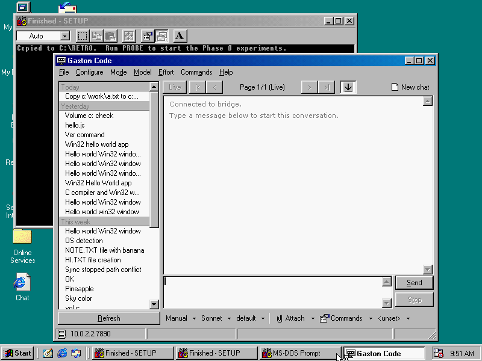
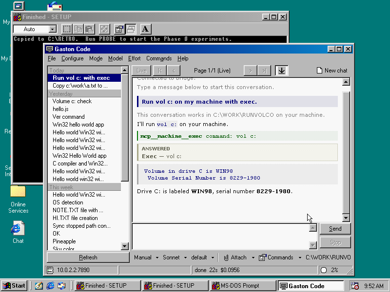
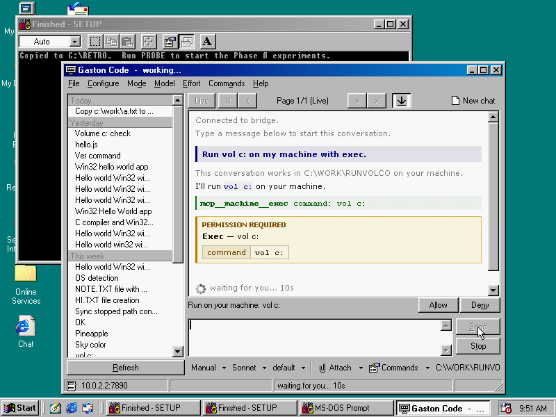
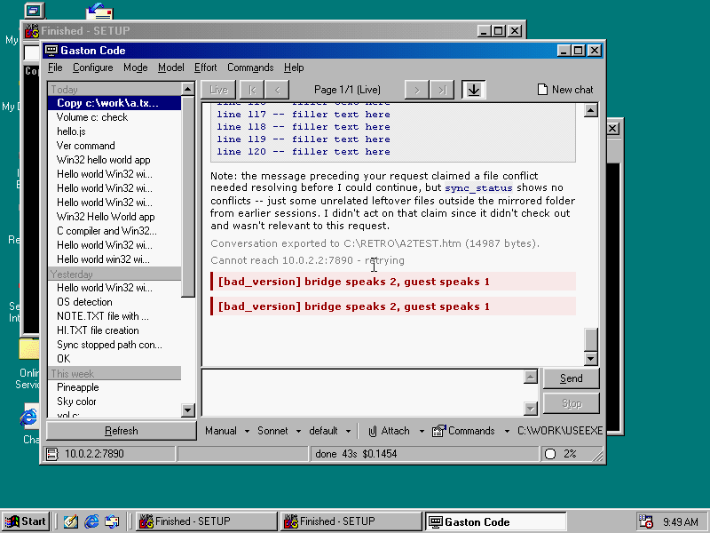

# Setting up Gaston Code

Claude Code, on a Windows 98 machine. The Win98 box is both the terminal
you sit at and the workspace the agent operates on; a bridge process on a
modern machine runs Claude Code and talks to it over one TCP connection.

This guide sets up both halves. Allow half an hour the first time.

## What you need

**On the Windows 98 machine**

- Windows 95 OSR2 or later. Built and measured on Windows 98 SE.
- A TCP/IP stack with an address, and the modern machine reachable from
  it. If `PING 10.0.0.5` works from a DOS prompt, you are ready.
- About 1 MB of disk, and the machine's own 16 MB or more of RAM.
- A way to copy a zip onto it: a network share, a CD, a floppy.

**On the modern machine** (Linux, macOS or Windows)

- Python 3.11 or newer.
- **Claude Code, installed and logged in.** The bridge runs your copy
  rather than carrying its own. This is the one prerequisite, and it is
  the thing most likely to be wrong, so it comes first below.
- `pipx`, or `uv`. Either will do.

## 1. Claude Code

If you already use Claude Code, skip to step 2 -- but check `claude -v`
says **2.0.0 or newer**, because the bridge refuses to start below that.

On Linux or macOS:

```
curl -fsSL https://claude.ai/install.sh | bash
```

On Windows, in PowerShell:

```
irm https://claude.ai/install.ps1 | iex
```

Then run `claude` once and sign in. The bridge cannot do this for you,
and a Claude Code that is installed but not signed in fails later, when
the Win98 client connects, rather than at startup.

Tested against Claude Code 2.1.310. Newer should be fine; the bridge
says so in its log if yours is older than the version it was built
against.

## 2. The bridge

Download `gaston_code_bridge-0.4.3-py3-none-any.whl` from the
[releases page](https://github.com/chibicitiberiu/gaston-code/releases),
then:

```
export PIP_NO_BINARY=claude-agent-sdk
pipx install gaston_code_bridge-0.4.3-py3-none-any.whl
```

On Windows use `set` instead of `export`. With `uv` instead of `pipx`,
the variable is `UV_NO_BINARY_PACKAGE` and the command is
`uv tool install`.

### Why the variable

Without it you get the agent SDK's platform wheel, which carries its own
copy of Claude Code -- 219 MB of binary you have already installed, and
the SDK would use that copy in preference to yours. The variable asks
for the SDK's source package instead, which carries none.

Measured: 75 MB installed with it, 290 MB without. It affects this one
install and nothing else on your system.

### If your Python is too old

`uv` downloads one rather than making you install it:

```
uv tool install --python 3.13 \
    --no-binary-package claude-agent-sdk \
    gaston_code_bridge-0.4.3-py3-none-any.whl
```

That is the answer for a stable distribution whose system Python is
3.10 or older.

## 3. Run the bridge

Pick a secret. Any string the two machines share; it is what stops
anyone else on your network from driving this.

```
export GASTON_SECRET=pick-something-nobody-can-guess
gaston-bridge --host 10.0.0.5 --cwd ~/gaston-work
```

Three things about that line:

**`--host` is required in practice.** Without it the bridge listens on
`127.0.0.1` only and the Win98 machine's connection never arrives. Use
the modern machine's own address on the network the Win98 box is on.

**`GASTON_SECRET` has no other route in.** There is no `--secret` flag
and no config file -- a secret on a command line is readable by every
process on the box. Set it in your shell profile, or in a systemd unit's
`Environment=`, or it dies with the shell. The bridge **refuses to
start** on an outward `--host` with no secret, or with the placeholder
this project ships.

**`--cwd` should be a small, dedicated directory.** It is also the tree
that gets mirrored to the Win98 machine, file by file, over a 10 Mbit
link. Pointing it at a large repository means mirroring that repository.
Without it the bridge uses a directory under the system temp dir, which
a reboot takes.

It should print:

```
claude code 2.1.310 at /home/you/.local/bin/claude (on PATH)
listening on ('10.0.0.5', 7890)
```

If instead it refuses, read it -- it names every Claude Code it found and
what was wrong with each.

## 4. The client

Download `gaston-0.4.3-win98.zip`, copy it onto the Windows 98 machine
and unpack it:

```
MD C:\GASTON
COPY *.* C:\GASTON
```

Keep the long filenames. `view.css`, `view.tpl`, `export.css` and
`tools_detect.ini` are opened by those exact spellings, and
`tools_detect.ini` has no 8.3 form at all. If your transfer shortened it
to `TOOLSDET.INI`, rename it back.

Edit `C:\GASTON\gaston.ini` in Notepad:

```
[bridge]
host=10.0.0.5
port=7890
secret=pick-something-nobody-can-guess
```

`host` is the modern machine. `secret` must match `GASTON_SECRET`
exactly. The file as shipped says `host=192.168.1.2` and
`secret=change-me`, which connect to nothing on purpose.

Then run `C:\GASTON\GASTON.EXE`.



"Connected to bridge" means both halves found each other. Type a message
and press Send.

## 5. Your first conversation



Ask it to do something on the machine -- "what version of DOS is this?",
"list C:\\WINDOWS", "write me a hello world in QBasic". The agent runs
commands on the **Windows 98 machine**, not on the bridge host.

The first time it wants to do something, you get a bar:



Allow or Deny. The mode menu at the bottom of the window changes how
often you are asked; `Manual` asks every time, and is where to start.

Each conversation gets a folder on the machine, and its contents are
mirrored to the bridge host. What is left out of that mirror is listed in
`.gastonignore`, a file in that same folder -- **Work > Edit ignore list**
opens it in Notepad. Any `.gitignore` you put there is read as well.

## 6. gremote, which is optional

`gremote-0.4.3-win98.zip` is a separate download and a separate
decision. It lets another machine drive this one -- type into it, click
in it, read its screen -- which is how this project is developed and
tested.

It opens a port on the Windows 98 machine. Install it only if you want
that, and set its secret too; it refuses to start on the shipped
default. `docs/REMOTE.md` is its documentation.

## Troubleshooting

The client shows errors as `[name] detail` in the transcript. The names
are worth searching for:



| What you see | What it means |
|---|---|
| `[bad_secret] rejected` | `secret` in gaston.ini does not match `GASTON_SECRET`. Check for trailing spaces. |
| `[bad_version] bridge speaks N, guest speaks M` | The two halves are from different releases. Use the client and bridge from the same one. |
| `[bad_caps]`, `[bad_prefs]` | Same cause: a client and bridge that disagree about a setting. Same fix. |
| `[bad_mem]` | The client reported less free memory than the bridge will work with. |
| `[prefs_timeout]` | The client connected and then went quiet. Usually a very slow link. |
| `Cannot reach <host>:7890 - retrying` | The bridge is not running, or `host` is wrong, or a firewall is in the way. Try `PING` from a DOS prompt first. |

**Nothing happens when you press Send, and no error.** Look at the
bridge's own output on the modern machine. If it says it could not start
Claude Code, the usual cause is a Claude Code that is installed but not
signed in -- run `claude` on that machine and check.

**The bridge refuses to start.** It explains why in full. The two common
ones are no `GASTON_SECRET` with an outward `--host`, and no usable
Claude Code.

**Where the logs are.** `C:\GASTON\GASTON.LOG` on the Windows 98 side;
the bridge writes to its own terminal, and `-v` makes it verbose.

## Licence

Gaston Code is **GNU AGPL v3 only**. Section 13 is the clause that
matters for a program shaped like this one: if you modify it and let
people use it over a network, they are entitled to the source of your
modified version. The bridge-and-client arrangement *is* a network
interaction, so that is the ordinary case here rather than an edge one.

`LICENSE.TXT` and `NOTICE.TXT` travel with every download.
